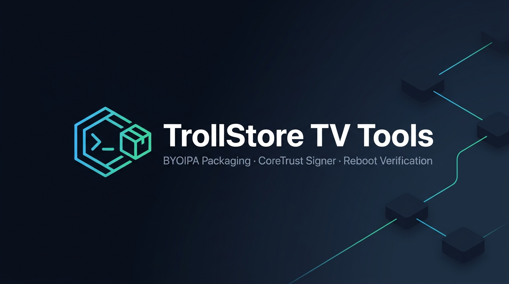
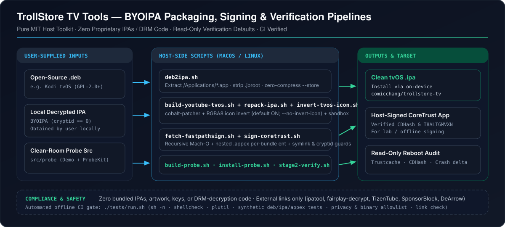

<p align="center">
  
</p>

<h1 align="center">TrollStore TV Tools</h1>

<p align="center">
  <a href="https://github.com/comicchang/trollstore-tv-tools/actions/workflows/ci.yml"></a>
  
  
</p>

<p align="center">
  <strong>English</strong> · <a href="README.zh-CN.md">简体中文</a> · <a href="#script-usage-reference">Scripts</a> · <a href="docs/APP-PACKAGING-GUIDE.md">BYOIPA Guide</a> · <a href="ROADMAP.md">Roadmap</a>
</p>

Companion host-side **BYOIPA packaging**, **CoreTrust batch signing**, **clean-room tvOS probe**, and **post-reboot verification** toolkit for **Apple TV 4K (`AppleTV14,1`, tvOS 17.0 / `21J354`)**.

<p align="center">
  
</p>

> Looking for the on-device permasigned IPA installer itself (`TrollStore.app` + `trollstorehelper`)? See **[`trollstore-tv`](https://github.com/comicchang/trollstore-tv)** (tvOS 17.0 CoreTrust cold-reboot survival) or **[`trollstore-lite-tv`](https://github.com/comicchang/trollstore-lite-tv)** (jailbroken tvOS 17.x+ trustcache installer with `:8787` web store).

---

## Which Repo Should I Choose?

| Repository | Role | Target Platform | License |
| --- | --- | --- | --- |
| **`trollstore-tv-tools`** *(this repo)* | Host-side packaging (`.deb` → `.ipa`, BYOIPA, icon inversion), CoreTrust batch signing, probe & reboot verification | macOS / Linux → tvOS 17.0 | Pure MIT |
| [`trollstore-tv`](https://github.com/comicchang/trollstore-tv) | On-device CoreTrust permasigned installer (`TrollStore.app` + `trollstorehelper`, cold-reboot unjailbroken survival) | **tvOS 17.0 (`21J354`)** | MIT + BSD-4-Clause (`uicache.m`) |
| [`trollstore-lite-tv`](https://github.com/comicchang/trollstore-lite-tv) | Clean-room kernel-trustcache installer (no CoreTrust exploit; TV UI + `:8787` web store + local userscript host) | **Any jailbroken tvOS 17.x+** | Pure MIT |

---

## What's Inside

| Tool / Component | Purpose | Runs On |
| --- | --- | --- |
| [`scripts/deb2ipa.sh`](scripts/deb2ipa.sh) | Convert open-source tvOS `.deb` packages (e.g. Kodi) into clean `.ipa` bundles | macOS / Linux |
| [`scripts/build-youtube-tvos.sh`](scripts/build-youtube-tvos.sh) | BYOIPA builder for YouTube tvOS + upstream [TizenTube](https://github.com/reisxd/TizenTube) ([SponsorBlock](https://github.com/ajayyy/SponsorBlock) / [DeArrow](https://github.com/ajayyy/DeArrow)) via [`tvos-cobalt-userscript`](https://github.com/comicchang/tvos-cobalt-userscript) (icon inversion ON by default; `--no-invert-icon` to disable) | macOS / Linux (`uv`) |
| [`scripts/repack-ipa.sh`](scripts/repack-ipa.sh) | Generic BYOIPA repackager: customize Bundle ID/name, invert icons by default (`--no-invert-icon` to disable), normalize standard sandbox entitlements for `TrollStore TV` | macOS / Linux |
| [`scripts/invert-tvos-icon.sh`](scripts/invert-tvos-icon.sh) | Pixel-exact RGBA8 inverter for tvOS layered `Assets.car` icons (recompiled with Xcode `actool`) | macOS (Xcode) |
| [`scripts/fetch-fastpathsign.sh`](scripts/fetch-fastpathsign.sh) | Reproducibly compile host `fastPathSign` from pinned upstream (`f1ebe52`) into gitignored `vendor/fastPathSign` | macOS (clang + OpenSSL) |
| [`scripts/sign-coretrust.sh`](scripts/sign-coretrust.sh) | Batch-sign any tvOS `.app` / `.ipa` (main binary + `Frameworks/` + `*.dylib`) with host `fastPathSign`, verify `CDHash` & `TeamIdentifier=T8ALTGMVXN`, and optionally repackage (`-o out.ipa`) | macOS host only |
| [`scripts/stage2-verify.sh`](scripts/stage2-verify.sh) | Read-only-by-default post-reboot verification over SSH (checks jailbreak state, trustcache, Mach-O CDHashes, CrashReporter delta, and optional `--launch`) | macOS → Apple TV (SSH) |
| [`scripts/build-probe.sh`](scripts/build-probe.sh) | Compile the clean-room `Demo.app` + embedded `ProbeKit.framework` arm64 tvOS diagnostic probe | macOS (Xcode tvOS SDK) |
| [`scripts/install-probe.sh`](scripts/install-probe.sh) | Jailbroken-state diagnostic probe installer (interactive `sudo` only, no stored credentials) | macOS → Apple TV (SSH) |
| [`src/probe/`](src/probe/main.m) | Minimal clean-room tvOS probe app logging ctor, `csops`, embedded framework call, UIKit lifecycle, loopback HTTP, and heartbeat | tvOS 17.0 arm64 |
| [`tests/run.sh`](tests/run.sh) | Local & CI verification gate (`sh -n`, `shellcheck`, plist lint, `--dry-run` smoke, privacy/binary guard, Markdown links, probe build) | macOS / Linux CI |

---

## Verification Highlights (Apple TV 4K / tvOS 17.0 `21J354`)

- **Zero-trustcache CoreTrust signing**: Host-signed multi-binary apps (`TeamIdentifier=T8ALTGMVXN`) launch cleanly with zero jailbreak trustcache writes — see [`docs/CORETRUST-BYPASS-VERIFIED.md`](docs/CORETRUST-BYPASS-VERIFIED.md).
- **Minimal sandboxed entitlements work**: Only `application-identifier` + `com.apple.private.security.container-required` are needed; no jailbreak-only entitlements required.
- **Cold-reboot unjailbroken survival verified**: Both `TrollStore.app` and multi-binary CoreTrust-signed apps launch directly after a full cold reboot on sealed read-only SSV tvOS 17.0 — see [`docs/REBOOT-VERIFICATION.md`](docs/REBOOT-VERIFICATION.md).

---

## Prerequisites

- **Common (macOS / Linux)**: POSIX `sh`, `zip`/`unzip`, `tar`, `ar` or `dpkg-deb`, `python3` (for `plistlib` on Linux).
- **macOS Xcode** (required for `invert-tvos-icon.sh`, `build-probe.sh`, and auto icon inversion in `repack-ipa.sh` / `build-youtube-tvos.sh`): full Xcode with AppleTVOS SDK (`actool`, `clang`, `codesign`, `plutil`).
- **OpenSSL + `pkg-config`** (macOS Homebrew, required only for `fetch-fastpathsign.sh`): `brew install openssl@3 pkg-config`.
- **[`uv`](https://docs.astral.sh/uv/)** (required only for `build-youtube-tvos.sh` to invoke `tvos-cobalt-userscript`).

---

## Script Usage Reference

Every script supports `-h` / `--help`, and mutating/remote scripts support `--dry-run`.

### 1. Convert an Open-Source `.deb` to `.ipa` (`scripts/deb2ipa.sh`)

Extracts `/Applications/*.app` (stripping `.jbroot` symlinks) and packages a clean `.ipa` ready for `TrollStore TV`:

```sh
# Dry-run preview
./scripts/deb2ipa.sh --dry-run /path/to/org.xbmc.kodi-tvos64.deb

# Convert Kodi .deb to .ipa (use --store for fast zero-compression packaging)
./scripts/deb2ipa.sh --store -o Kodi.ipa /path/to/org.xbmc.kodi-tvos64.deb
```

### 2. Build YouTube tvOS with TizenTube / SponsorBlock (`scripts/build-youtube-tvos.sh`)

Operates strictly on **your own locally decrypted IPA (`cryptid == 0`)** — see [`docs/APP-PACKAGING-GUIDE.md`](docs/APP-PACKAGING-GUIDE.md) for the full Step 1–4 BYOIPA guide:

```sh
# Dry-run preview
./scripts/build-youtube-tvos.sh --dry-run /path/to/YouTube-decrypted.ipa

# Build side-by-side YouTube TV IPA (icon inversion is ON by default)
./scripts/build-youtube-tvos.sh -o YouTubeTV-trollstore.ipa /path/to/YouTube-decrypted.ipa

# Keep original YouTube icon (--no-invert-icon) or point to a custom/LAN userscript URL
./scripts/build-youtube-tvos.sh \
  --no-invert-icon \
  --userscript-url https://cdn.jsdelivr.net/npm/@foxreis/tizentube/dist/userScript.js \
  -o YouTubeTV-trollstore.ipa \
  /path/to/YouTube-decrypted.ipa
```

Key flags: `--bundle-id`, `--display-name`, `--app-name`, `--profile`, `--userscript-url`, `--fallback-url`, `--extra-csp`, `--invert-icon` (default ON) / `--no-invert-icon`, `--no-4k-patch`, `--no-hdr-patches`, `--store`, `-o`.

### 3. Generic Local IPA Repackaging (`scripts/repack-ipa.sh`)

Customize Bundle ID / Display Name, invert tvOS icons (auto-ON on macOS; `--no-invert-icon` to disable), and normalize standard sandbox entitlements for `TrollStore TV`:

```sh
./scripts/repack-ipa.sh \
  --bundle-id com.example.myapp.custom \
  --display-name "My App Custom" \
  --entitlements sandbox \
  -o MyApp-custom.ipa \
  /path/to/MyApp-unencrypted.ipa
```

Key flags: `--bundle-id`, `--display-name`, `--invert-icon` / `--no-invert-icon`, `--entitlements sandbox|preserve|<plist>`, `--allow-alt-video-decoder`, `--store`, `--dry-run`, `-o`.

### 4. Standalone tvOS Layered Icon Inverter (`scripts/invert-tvos-icon.sh`)

Pixel-exact RGBA8 color inversion for tvOS `Assets.car` (handles monochrome `gray gamma 22` assets where `CIColorInvert` is a no-op) and recompiles via Xcode `actool`:

```sh
./scripts/invert-tvos-icon.sh --dry-run -o /tmp/Assets-inverted.car /path/to/Assets.car
./scripts/invert-tvos-icon.sh -o Assets-inverted.car /path/to/Assets.car
```

### 5. Build Host `fastPathSign` & Batch CoreTrust Signing (`scripts/fetch-fastpathsign.sh` + `scripts/sign-coretrust.sh`)

`fastPathSign` must run on the **macOS host** (running it directly on tvOS exits with `Killed: 9`):

```sh
# Build vendor/fastPathSign once from pinned upstream f1ebe52 (--force to rebuild)
./scripts/fetch-fastpathsign.sh

# Dry-run preview (no files modified)
./scripts/sign-coretrust.sh --dry-run --entitlements minimal path/to/App.app

# Batch-sign main binary + Frameworks/ + *.dylib and write repackaged output IPA
./scripts/sign-coretrust.sh --entitlements minimal -o SignedApp.ipa InputApp.ipa
```

> **Important**: If you plan to install an IPA via on-device `TrollStore TV` (`trollstorehelper`), do **not** pre-run `sign-coretrust.sh`; pass an unsigned or standard ad-hoc IPA instead (`trollstorehelper` signs it on-device).

### 6. Clean-Room Diagnostic Probe (`scripts/build-probe.sh` + `scripts/install-probe.sh`)

```sh
# Compile Demo.app + embedded ProbeKit.framework (tvOS arm64)
./scripts/build-probe.sh

# Dry-run or install onto a jailbroken Apple TV (interactive sudo only, no stored credentials)
./scripts/install-probe.sh --dry-run
DEVICE=192.0.2.10 ./scripts/install-probe.sh
```

### 7. Post-Reboot Verification (`scripts/stage2-verify.sh`)

Read-only by default; never triggers automatic reboots:

```sh
# Preview remote checks
./scripts/stage2-verify.sh --dry-run

# Read-only post-reboot inspection (jailbreak state, trustcache, Mach-O CDHashes, CrashReporter)
./scripts/stage2-verify.sh --device 192.0.2.10 --user mobile

# Optional launch test (only when display is connected)
./scripts/stage2-verify.sh --device 192.0.2.10 --launch
```

### 8. Run Local Verification Suite (`tests/run.sh`)

```sh
./tests/run.sh
```

---

## Documentation

- [`docs/APP-PACKAGING-GUIDE.md`](docs/APP-PACKAGING-GUIDE.md) / [简体中文](docs/APP-PACKAGING-GUIDE.zh-CN.md) — **BYOIPA & `.deb`-to-`.ipa` packaging guide** (Kodi `.deb` conversion + data migration, YouTube BYOIPA workflow, generic repackaging)
- [`docs/REBOOT-VERIFICATION.md`](docs/REBOOT-VERIFICATION.md) — Cold-reboot safety checklist, unjailbroken survival proof, and troubleshooting notes (`IOSurfaceRootUserClient`, monochrome tvOS `Assets.car`)
- [`docs/CORETRUST-BYPASS-VERIFIED.md`](docs/CORETRUST-BYPASS-VERIFIED.md) — Zero-trustcache CoreTrust signing measurements (full & minimal entitlements)
- [`docs/DEVICE-RECIPE.md`](docs/DEVICE-RECIPE.md) — Reproducible jailbroken probe recipe & troubleshooting matrix
- [`docs/UPSTREAM-FLOW-AUDIT.md`](docs/UPSTREAM-FLOW-AUDIT.md) — Upstream TrollStore signing and installation flow audit
- [`docs/CONTAINER-BLACKLIST-NOTE.md`](docs/CONTAINER-BLACKLIST-NOTE.md) — `jbctl trustcache add` container-path blacklist workaround
- [`docs/evidence/probe-run.log`](docs/evidence/probe-run.log) & [`docs/evidence/probe-boot.log`](docs/evidence/probe-boot.log) — Clean-room probe runtime logs

---

## Credits & Referenced Third-Party Projects

None of the third-party projects below are vendored or redistributed inside this repository; they are either fetched/built locally by the user, loaded at runtime by URL, or referenced as external ecosystem tools:

| Project | Author / Maintainer | License | Role |
| --- | --- | --- | --- |
| [`opa334/TrollStore`](https://github.com/opa334/TrollStore) | Lars Fröder (`opa334`) | MIT | CoreTrust signing & installation architecture reference |
| [`straight-tamago/TrollStore-tvOS`](https://github.com/straight-tamago/TrollStore-tvOS) | `straight-tamago` | MIT | Upstream `Exploits/fastPathSign` source compiled locally via `scripts/fetch-fastpathsign.sh` (`f1ebe52`) |
| [`opa334/ChOma`](https://github.com/opa334/ChOma) | Lars Fröder, `@alfiecg_dev`, `@LinusHenze`, Google TAG & contributors | MIT | Mach-O / CoreTrust bypass signing library used by `fastPathSign` and `trollstore-tv` |
| [`reisxd/TizenTube`](https://github.com/reisxd/TizenTube) | Reis Can (`reisxd`) | GPL-3.0 | Default runtime userscript (`@foxreis/tizentube` via jsDelivr) for YouTube TV ad-blocking & UI enhancements; not vendored |
| [`reisxd/TizenTubeCobalt`](https://github.com/reisxd/TizenTubeCobalt) | Reis Can (`reisxd`) | BSD-3-Clause | Companion Cobalt YouTube TV project by `reisxd` |
| [`ajayyy/SponsorBlock`](https://github.com/ajayyy/SponsorBlock) | Ajay Ramachandran (`ajayyy`) & contributors | GPL-3.0 / CC BY-NC-SA 4.0 (API DB) | Community sponsor-segment skipping service ([sponsor.ajay.app](https://sponsor.ajay.app)) integrated at runtime by TizenTube |
| [`ajayyy/DeArrow`](https://github.com/ajayyy/DeArrow) | Ajay Ramachandran (`ajayyy`) & contributors | GPL-3.0 | Crowdsourced non-clickbait titles & thumbnails ([dearrow.ajay.app](https://dearrow.ajay.app)) integrated at runtime by TizenTube |
| [`comicchang/tvos-cobalt-userscript`](https://github.com/comicchang/tvos-cobalt-userscript) | Comic Chang | MIT | Clean-room ARM64 Cobalt userscript-loader patcher invoked by `scripts/build-youtube-tvos.sh` |
| [`majd/ipatool`](https://github.com/majd/ipatool) | Majd Alfhaily (`majd`) | MIT | External CLI referenced in docs for downloading your own App Store `.ipa` |
| [`EthanArbuckle/fairplay-decrypt`](https://github.com/EthanArbuckle/fairplay-decrypt) | Ethan Arbuckle | GPL-3.0 | External third-party FairPlay decryption project linked for reference only; zero code included |
| [`xbmc/xbmc`](https://github.com/xbmc/xbmc) ([Kodi](https://kodi.tv/)) | XBMC Foundation / Team Kodi | GPL-2.0+ | Open-source tvOS media center referenced as a `.deb`-to-`.ipa` conversion example |
| [`owngoal-dev/Relaxin`](https://github.com/owngoal-dev/Relaxin) & [`roothide`](https://github.com/roothide) | owngoal-dev, roothide | MIT | tvOS 17 RootHide jailbreak environment used for probe testing & initial bootstrap |
| [`ProcursusTeam/ldid`](https://github.com/ProcursusTeam/ldid) | Procursus Team | GPL-3.0 | External device-side entitlement inspection tool referenced in docs |
| [`openssl/openssl`](https://github.com/openssl/openssl) | OpenSSL Project | Apache-2.0 | Local host dependency when compiling `vendor/fastPathSign` |
| [`astral-sh/uv`](https://github.com/astral-sh/uv) | Astral | MIT / Apache-2.0 | Local Python environment runner used by `scripts/build-youtube-tvos.sh` |

Related repositories:
- [`comicchang/trollstore-tv`](https://github.com/comicchang/trollstore-tv) — on-device CoreTrust permanent installer for tvOS 17.0 (`TrollStore.app` + `trollstorehelper`).
- [`comicchang/trollstore-lite-tv`](https://github.com/comicchang/trollstore-lite-tv) — clean-room jailbreak trustcache installer for jailbroken tvOS 17.x.

---

## Safety & License

- Scripts are read-only by default, never trigger automatic reboots, never touch `/Applications`, and never store passwords, keys, or third-party compiled binaries.
- Licensed under [MIT](LICENSE). See [NOTICE](NOTICE), [CHANGELOG.md](CHANGELOG.md), [CONTRIBUTING.md](CONTRIBUTING.md), and [SECURITY.md](SECURITY.md).
